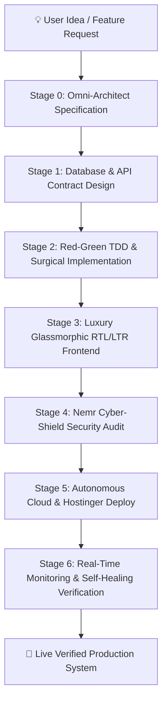

# 👑 Nemr Omni-Apex AI Engineering OS (`nemr-apex-omni`)
> **"From a single thought to an enterprise-grade digital empire in production."**  
> *Architected for ElNeMeR by DeepMind Antigravity Cognitive Core.*

---

## 🏛️ The 7 Sovereign Laws of Nemr Engineering

1. **Zero Hallucination, 100% Grounded Truth**:
   Never guess APIs, database schemas, library methods, or file paths. Query codebase ASTs and inspect live environments first before generating code.
2. **AST-Surgical Minimal Diffs (Karpathy First Law)**:
   Never re-write or dump 500-line files. Edit exact symbols, functions, or specific blocks. Save 85% output tokens and prevent accidental regressions.
3. **Obra Red-Green-Refactor Test Rigor**:
   Write reproducing or unit tests *first*. Run tests, confirm failure (Red), write minimal surgical code, verify passage (Green), then refactor safely.
4. **Zero-Trust Security & Sovereign Armor (OWASP Top 10)**:
   Every input is untrusted. Prepared statements for all SQL queries. Strict rate limiting, anti-CSRF tokens, parameterized headers, and zero leaked secrets in client bundles.
5. **Arabic-First RTL Luxury Design with Instant Bilingualism**:
   Every web application must feature a breathtaking dark obsidian/glassmorphic aesthetic with Google Cairo/Tajawal Arabic fonts, seamless LTR/RTL toggle, responsive mobile UX, and zero placeholder buttons.
6. **Self-Healing Autopilot**:
   When an error occurs (500, crash, stack trace, syntax error), never panic or deflect to the user. Automatically extract the trace, locate the exact file and line, apply the atomic fix, and verify resolution.
7. **1-Click Multi-Cloud Sovereign Deployment**:
   Code is never complete until it is deployed, verified with HTTP 200, and live with active SSL and working database connections across Hostinger Account 1 (`hostinger`) or Account 2 (`hostinger-2`).

---

## 🗺️ Master Architecture & Execution DAG



---

## 🛠️ Stage 0: Omni-Architect Specification

When given a prompt to build any tool, SaaS, or feature:
1. **Define Core Value Proposition**: What problem does this solve in 1 sentence?
2. **User Personas & Permissions**: Admin, Staff, Client, Guest (Role-Based Access Control).
3. **Data Model (ERD)**: Entities, primary/foreign keys, indexes, cascades, JSON metadata columns.
4. **API Contracts**: Standard RESTful JSON specification (`GET /api/v1/...`, `POST /api/v1/...`, with uniform response envelope: `{ status: "success", data: {...}, meta: {...} }`).
5. **Storage Strategy**:
   - Small/Shared Subdomains: MySQL PDO with auto-migrating tables on first run (`CREATE TABLE IF NOT EXISTS`).
   - Enterprise: PostgreSQL or MySQL with migration scripts.

---

## ⚡ Stage 1: The Luxury UI/UX Design System (Obsidian Glass)

Every frontend built under this skill MUST incorporate this elite design system:

* **Color Palette**:
  - Background: Deep Void Obsidian (`#06080e`, `#090d16`) with radial glow accents (`radial-gradient(circle at top, rgba(14, 165, 233, 0.08), transparent 60%)`).
  - Card Surfaces: Frost Glass (`rgba(15, 23, 42, 0.65)` with `backdrop-filter: blur(20px)` and border `1px solid rgba(255, 255, 255, 0.07)`).
  - Primary Accent: Sovereign Gold (`#f59e0b` / `#fbbf24`) for ElNeMeR / Luxury tools, or Cyber Cyan / Emerald (`#06b6d4` / `#10b981`) for AI & Security systems.
  - Text Hierarchy: Primary `#f8fafc`, Secondary `#94a3b8`, Muted `#64748b`.
* **Typography**:
  - Arabic: `'Cairo', 'Tajawal', sans-serif` (Google Fonts).
  - English / Code: `'Inter', 'JetBrains Mono', monospace`.
* **Micro-Interactions**:
  - Live metric counters with ticking animations.
  - Interactive toast notifications (Success, Alert, Error).
  - Export capabilities out-of-the-box (CSV, JSON, PDF/Print).
  - Instant Light Mode / Dark Mode and English / Arabic LTR/RTL toggle.

---

## 🔒 Stage 2: Sovereign Cybersecurity Shield (OWASP Top 10)

Before any code is deployed, execute this 8-point automated security protocol:

1. **SQL Injection**: 100% Parameterized queries using PDO `prepare()` and `execute()`. Zero string concatenation inside SQL statements.
2. **Cross-Site Scripting (XSS)**: All dynamic output sanitized via `htmlspecialchars($val, ENT_QUOTES, 'UTF-8')` or modern framework escaping (`textContent`, React JSX).
3. **Cross-Site Request Forgery (CSRF)**: Anti-CSRF token verification on state-changing requests (`POST`, `PUT`, `DELETE`).
4. **Broken Access Control (IDOR)**: Verify user ownership on every resource query (`WHERE id = :id AND user_id = :current_user`).
5. **Security Headers**:
   ```apache
   Header set X-Content-Type-Options "nosniff"
   Header set X-Frame-Options "SAMEORIGIN"
   Header set X-XSS-Protection "1; mode=block"
   Header set Referrer-Policy "strict-origin-when-cross-origin"
   Header set Permissions-Policy "geolocation=(), microphone=(), camera=()"
   ```
6. **Secret Sanitization**: Zero API keys or database passwords committed to frontend bundles. All secrets read from environment variables or protected `.env` files with `400` permissions.
7. **Rate Limiting**: IP-based sliding window rate limiter (max 60 requests/minute per client IP) on public endpoints.
8. **Ghost Route Audit**: Ensure debug routes, `.git`, `phpinfo()`, and backup files (`.bak`, `.zip`) are blocked by `.htaccess`.

---

## 💳 Stage 3: Multi-Gateway Monetization Integration

Support instant drop-in monetization for Middle East, Gulf, and Global markets:

* **Paymob (Egypt & Gulf - Cards, Wallets, Meeza, Kiosk)**:
  - Step 1: Authentication request (`/api/auth/tokens`).
  - Step 2: Order registration (`/api/ecommerce/orders`).
  - Step 3: Payment key generation with billing data (`/api/acceptance/payment_keys`).
  - Step 4: Webhook HMAC-SHA512 verification handler.
* **Fawry (Egypt Cash & Reference Numbers)**:
  - Signature hash: `SHA256(merchantCode + merchantRefNum + userProfileId + paymentMethod + amount + secretKey)`.
* **Stripe (Global Credit/Debit Cards & Apple Pay)**:
  - Checkout session creation + webhook signing secret verification (`Stripe-Signature`).
* **Cryptomus / Crypto (USDT, BTC, ETH)**:
  - Multi-chain cryptocurrency invoices with automated webhook confirmations.

---

## 🚀 Stage 4: 1-Click Hostinger Multi-Account Deployment

### Mapping Hostinger Accounts:
* **Account 1 (`hostinger` MCP Server - استضافة النمر):**
  - Username: `u511081796` | Order ID: `1008051277`
  - Domains: `elnemer-ai.com`, `chatbotgold.net`, `sultanelnemer.click`, `mourjangold.com`, `playpoki.fun`, `hadiths.click`, etc.
* **Account 2 (`hostinger-2` MCP Server - استضافة هيام / شمس):**
  - Username: `u432802975` | Order ID: `1006226659`
  - Domains: `hayamgomaa.in`, `hayamgomaa.net`, `m-shams.com`, `mahmoudshamss.com`, `absathak.com`, `ahmedshams.online`, `hoyamstore.com`.

### The Instant Provisioning Workflow:
1. **Subdomain & DNS**: Ensure DNS records point to server IP with HTTPS/SSL enabled.
2. **MySQL Database & User**: Provision database via `database_create-database` and user via `database_create-user` if dynamic storage is required; inject credentials into `.env`.
3. **Packaging & Deployment**:
   - For Git repos: Call `hosting_git_deploy-website-repository` to pull branch directly.
   - For direct static / PHP apps: Package clean archive and deploy directly to document root.
4. **Post-Deployment Verification**:
   - Execute HTTP `GET` request to verify HTTP 200 OK.
   - Test API endpoints and database connectivity.
   - Verify mobile responsiveness and SSL certificate validity.

---

## 🔄 Stage 5: Self-Healing & Quota-Optimized Maintenance

1. **Quota Sentinel**: Check real model capacity before launching massive tasks.
   - If Argon or Claude are depleted (0%), route all tasks to `gemini-3.8-flash-high` or `gemini-4-hydrogen-high`.
   - Never stall or fail; maintain graceful fallback execution across available model pools.
2. **Automated Error Pinpointing**:
   - Parse error logs from `~/.system_generated/tasks/` or Apache error logs.
   - Extract exact failing file, line number, and stack frame.
   - Execute atomic patch and verify resolution with hot-reload or restart.

---

## 🏆 Summary Checklist for Every Delivered Project

- [ ] Zero placeholder buttons or dead links.
- [ ] Database tables auto-migrate on first run.
- [ ] RTL Arabic & LTR English bilingual support with luxury dark glassmorphism.
- [ ] OWASP Top 10 security audited (zero SQLi, XSS, CSRF, or leaked secrets).
- [ ] Deployed live to target domain with HTTP 200 and verified SSL.
- [ ] Mobile responsive on all screen sizes (iPhone, Android, Tablet, Desktop).
- [ ] Export features (CSV / JSON / PDF) functional.
